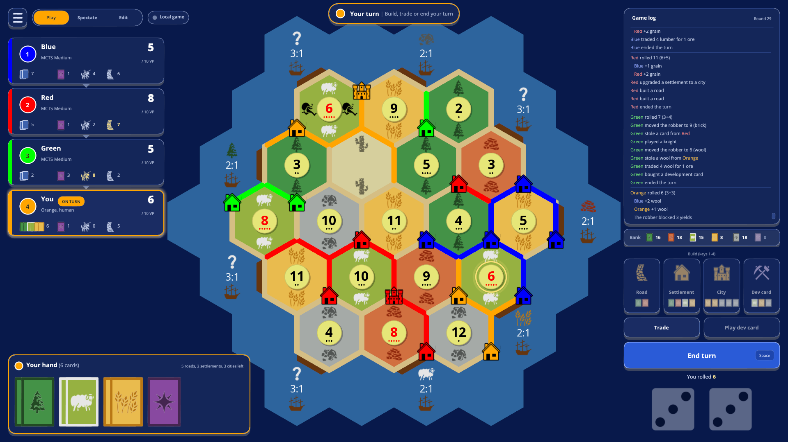

# CatanSim
Settlers of Catan simulator and AI agent sandbox featuring ML-based and handcrafted agents, a parallelized dataset generator, and save file serialization.

## Structure
The codebase is divided into several projects:
- **Agents:** Implementation of various game playing agents/bots and their underlying models.
- **Arena:** Duel CLI for comparing agents: mirror duels of two MCTS agents (every map played twice with the sides swapped) with an Elo estimate and an SPRT that stops once one side is clearly stronger.
- **Client:** Simulator GUI frontend enabling manual and automatic playouts, detailed game analysis, board editing, simulator configuration and state saving/loading.
- **Common:** Simulator library containing game data structures, transactional action system (undo/redo), move legality validation, YAML serialization, and map generation.
- **DatasetCollector:** High-performance dataset generator CLI for large-scale Catan simulation datasets.
- **DatasetProcessing:** Formatting tool for the conversion of simulator save files into feature vectors and grouped train/val/test splitting.
- **SelfPlayCollector:** Self-play data generator CLI: many games played at once by MCTS on one value net, recording positions with the search's values and visits, and every game as a save file.
- **Server:** Simulator server for online multiplayer (future work).

## Client
The client has three modes, switched at the top left (or with F1-F3):
- **Play:** each seat is a human or an agent (menu > New game). Humans pick their moves on the board, where the legal spots show up as pulsing ghost pieces, and in dialogs for discarding, robbing, trading and development cards; they only see their own hand. Space rolls or ends the turn, 1-4 pick road, settlement, city and development card, T trades, Esc cancels.
- **Spectate:** agents play all seats (human seats by a stand-in agent), with pause (Space), single steps (Right), and back and forth through the moves. The eval bar shows the win chances from the value net or the search, the heat map the acting player's policy over its legal moves: the search's visit shares while it thinks, otherwise the net's priors.
- **Edit:** place and remove pieces, move the robber and hand out cards for any player; every edit can be undone (Ctrl+Z) and redone (Ctrl+Y) and appears in the log.

F12 saves a screenshot. The developer tools (menu) hold map generation, rendering switches, agent budgets and playouts. Command line: `--scene NAME` starts in a preset situation (setup, main, road, roll, discard, robber, trade, devcards, spectate, edit, end), `--size WIDTHxHEIGHT` sets the window size, `--screenshot FILE --after SECONDS` saves a screenshot and quits, and `--selftest GAMES` plays games through the UI's move and edit paths and checks undo and redo.

## Value Net
The ML-based agents and the client's state evaluation use an ONNX state value network hosted at [Lahusa/catansim-state-value-net](https://huggingface.co/Lahusa/catansim-state-value-net). The build downloads it into `Agents/Artifacts/` when it is missing and verifies its checksum (disable with `-p:DownloadStateValueNet=false`). The deployed model is set by `StateValueNetModel` in `Agents/Agents.csproj`.

## Credits
Programming by Lasse Huber-Saffer.

The client depends on [SFML.Net](https://www.sfml-dev.org/), [ImGui.Net](https://github.com/ImGuiNET/ImGui.NET), and [ImGuiSFML](https://www.nuget.org/packages/Saffron.Util.ImGuiSFML/1.3.0/).

Icons are provided by [Game-Icons.net](https://game-icons.net/) as [CC-BY](https://creativecommons.org/licenses/by/4.0/deed): 
- "backup", "cash", "folded-paper", "galleon", "hourglass", "pine-tree", "stone-crafting", "uncertainty", "wheat" by Lorc
- "bank", "brick-pile", "cactus", "castle", "check-mark", "confirmed", "dice-six-faces-one", "dice-six-faces-two", "dice-six-faces-three", "dice-six-faces-four", "dice-six-faces-five", "dice-six-faces-six", "house", "next-button", "polar-star", "robber", "rolled-cloth", "scroll-quill", "sheep", "sickle", "stone-path", "stone-pile", "thumb-down", "thumb-up", "village", "wood-pile" by Delapouite
- "cancel" by sbed
- "mounted-knight" by Skoll
